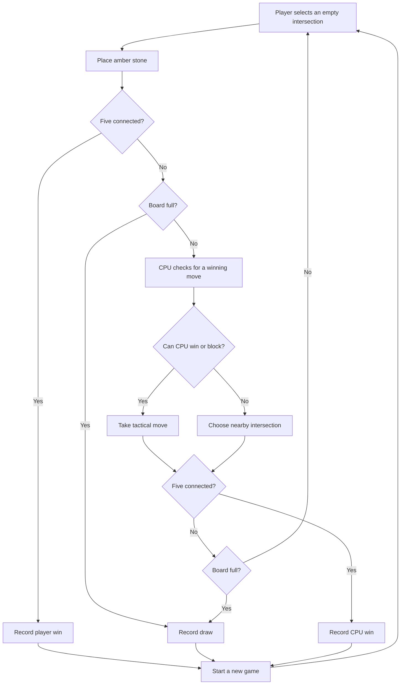

# Five Ember

A quiet board, a sharp opponent. Five Ember is a polished browser version of Gomoku: place amber stones, connect five in a row, and outmaneuver the cyan CPU. Built with Vue 3, TypeScript, and Vite; there is no backend.

**Play:** <https://oscarmmi.github.io/gomoku/>

## How to play

- Take turns placing a stone on an empty intersection of the 13 × 13 board. You play amber; Ember CPU plays cyan.
- Connect five or more stones horizontally, vertically, or diagonally to win. A full board without a five is a draw.
- Click or tap an intersection to place a stone. On a keyboard, use the arrow keys to move the highlight and press **Enter** or **Space** to place.
- Press **R** or select **New game** to start over. Your win, loss, and draw record is saved in this browser.
- Ember takes a winning move when available, blocks your immediate win, or develops near the existing stones.

## Run locally

```sh
npm install
npm run dev
```

Run the game-logic tests and create a production build with:

```sh
npm test
npm run build
```

## Game loop



## Built with

- Vue 3 and TypeScript
- Vite and Vitest
- Original CSS-rendered amber and cyan stones
